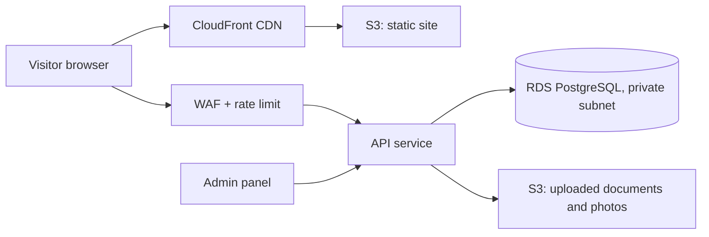

# VRIKSH Website: Redesign POC

Proof-of-concept redesign of [vrikshindia.in](https://vrikshindia.in), the timber legality verification standard of the Export Promotion Council for Handicrafts (EPCH). This repository is the design reference and starting point for the production build.

**Live preview:** `https://<github-username>.github.io/<repository-name>/` (see "Publish on GitHub Pages" below)

> Status: POC. The certificate search uses 4 fake demo records. No database or backend is connected yet.

---

## 1. What is in this repository

```
index.html          Main single-page site (hero, search, about, certification, shipment, governance, notifications)
app-manual.html     VRIKSH Mobile App User & Operations Manual, with "Download PDF"
contact.html        Contact page with enquiry form (see note below)
images/             VRIKSH and EPCH logos, five hero photos (hero-1.jpg to hero-5.jpg)
.nojekyll           Tells GitHub Pages to serve the files as they are
.gitignore          Ignores system and secret files
```

Run locally: open `index.html` in a browser, or use the VS Code "Live Server" extension.

---

## 2. (a) Current stack

| Area | What is used |
|---|---|
| Pages | 2 static HTML5 pages. No framework, no build step, no backend |
| Styling | CSS3: custom properties, grid and flexbox, `aspect-ratio`, `backdrop-filter`, automatic dark mode (`prefers-color-scheme`) |
| Scripting | Plain JavaScript: photo carousel (auto-advance, swipe, keyboard, pause), tabs, scroll-reveal (`IntersectionObserver`), smooth scroll, search form |
| Fonts | Apple system font stack (SF Pro) with Inter (Google Fonts) as fallback |
| PDF download | html2pdf.js 0.10.1 (html2canvas + jsPDF) from the cdnjs CDN. Produces an image-based PDF |
| Images | Resized JPEG and PNG |
| Accessibility | ARIA roles and labels, visible keyboard focus, reduced-motion support, pause control on the slideshow |
| Hosting (POC) | GitHub Pages |
| Not present | Framework, database, API, CMS, login, analytics |

Where the demo data lives: the certificate search in `index.html` filters a small `DATA` array in the page script. The agency replaces this with a call to the new API.

---

## 3. (b) Proposed architecture



- **Front end:** keep the static HTML, CSS and JS as the visual reference. Porting to Next.js or Astro is acceptable only if the agency will maintain it.
- **API:** small service in Node.js or Python (FastAPI), in the same AWS VPC as the database. A browser must never connect to the database directly.
- **Database:** Amazon RDS for PostgreSQL, Single-AZ to start (db.t4g.micro, upgrade to small if needed), in the Mumbai region (ap-south-1), private subnet, no public access. Add Multi-AZ at go-live only if uptime requires it.
- **Static hosting:** S3 + CloudFront for production. GitHub Pages is for the pilot only.
- **Domain:** use a subdomain such as `new.vrikshindia.in`. Leave the main domain unchanged until the new site reaches feature parity.
- **Cost (indicative, verify in the AWS Pricing Calculator):** pilot database, storage, small API and static hosting roughly USD 20 to 40 per month.

### Data

- **Legacy data:** certificate holder data already exists in the current VRIKSH system. The agency must audit, clean and migrate it, and report row counts before and after. Do not re-key it.
- **Core tables:** `organizations`, `licenses` (certificates), `products`, `shipment_certificates`, `documents`, `notifications`, `news_events` (photo, caption, date), `admin_users`, `audit_log`.
- **Search fields (from the live site):** License Code; Organization: Name, Contact Person, State/Country; Product: Production of, Manufactured From, Originating from.
- **Indexes:** unique index on license code; trigram (`pg_trgm`) indexes for partial text search.

### Features to build

- Certificate search API: `GET /api/certificates` with the filters above, pagination, and public fields only; result view with validity status and expiry date.
- Shipment certificate forms and documents: working links, later online submission.
- Admin panel with secure login to manage hero photos and captions, notifications, press items and documents without code changes.
- App manual page with PDF download (a ready-made text PDF is preferred over browser-generated).
- Contact form with email delivery and spam protection.
- Redirects from every old `index.php/user/...` URL to its new page.

### Security and compliance

- HTTPS only; AWS WAF; secrets in AWS Secrets Manager; least-privilege access.
- Database encrypted at rest, automated backups with 7-day retention, no public access.
- Rate limiting and CAPTCHA on certificate search to prevent harvesting of the registry.
- Personal data (for example contact person names): confirm compliance with India's Digital Personal Data Protection Act, 2023.
- Basic vulnerability test before go-live, with the report shared with EPCH.
- AWS account created under EPCH's name, not the agency's. EPCH owns the code, designs and data.

### Quality bar and acceptance criteria

- Visual fidelity: matches this POC unless a change is approved in writing.
- Lighthouse on mobile: 90 or above for Performance, Accessibility and SEO.
- Accessibility: WCAG 2.1 AA.
- Browsers: current Chrome, Safari, Edge and Firefox; iOS and Android phones.
- Search: 95th percentile response under 500 ms on the production dataset.
- SEO: all old URLs redirect (301); sitemap and metadata in place.
- Monitoring: uptime alerts and analytics (GA4 or equivalent).
- Handover: full source code, infrastructure documentation, AWS access, and a support period (30 to 90 days) with a fix SLA.

### Contact form

`contact.html` has a working form but no backend yet. In the page script, `CONFIG.endpoint` is empty, so the form opens the visitor's email app addressed to `CONFIG.to`. The agency sets `CONFIG.endpoint` to the new API route (JSON POST with name, org, email, phone, topic, message) and adds server-side validation, spam protection (CAPTCHA) and email delivery. Verify the address, phone numbers and email shown on the page against the official VRIKSH contact page before go-live.

### Open items from the POC

- VRIKSH logo is only 132 px wide; a vector or large PNG is needed.
- Apple's SF Pro cannot be embedded on a website. Self-host Inter, or accept SF on Apple devices and Inter elsewhere.
- Confirm usage rights for the event photos.
- Replace the 4 demo records with real data.

---

## 4. Publish on GitHub Pages

1. Push this folder to a **public** GitHub repository (keep the `images` folder).
2. Repository **Settings > Pages > Build and deployment > Source: Deploy from a branch**.
3. Branch `main`, folder `/ (root)`, then **Save**.
4. After 1 to 2 minutes the live link appears at the top of the Pages settings.

To update the site, edit the files, commit and push. The live site refreshes in about a minute.

To change a hero caption, edit the matching `<figcaption>` text in `index.html`. To change a photo, replace the file in `images/` with the same name.

---

© VRIKSH and EPCH. All rights reserved. Logos and photographs belong to EPCH.
